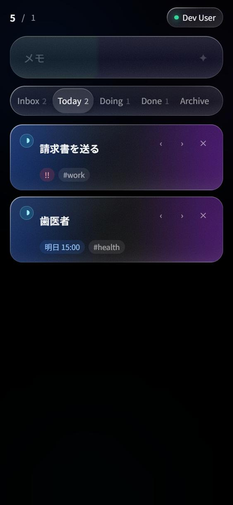

# GlassTask

開いた瞬間に書ける、フリックでステータスを動かすタスク管理。
Cloudflare Workers + D1 + Workers AI、Google サインイン。

- **入力はネットワークを待たない。** 入力欄は最初のフレームでフォーカス済み。ロード中でもそのまま打てて、1 打鍵でスケルトンが消える。保存は React state → localStorage → ネットワークの順で、失敗分はキューに残って次回サインイン時に再送される。
- **ステータスはフリックで動かす。** `inbox → today → doing → done → archived` の 1 本の軸を、右で進め、左で戻す。両端はクランプするので連打しても壊れない。
- **メモはその場で構造化される。** `明日 17:00 請求書を送る #work !!` と打つと、期限・タグ・優先度に分解される。これは決定的パーサで、AI は使わない。`✦` を押したときだけ Workers AI が走って、結果を**上書きではなく加算**する。



## 動かす

```bash
npm install
npm run db:migrate:local
npm run dev
```

`http://localhost:5173` が開く。Cloudflare アカウントは要らない。

アカウントシートの「ローカルサインイン (dev)」で D1 への同期まで一通り試せる
（localhost からのリクエストのときだけ有効で、デプロイ先では 404 を返す）。

### テスト

```bash
npm test          # 61 件
npx tsc -b        # 型チェック（app / worker / node の 3 プロジェクト）
```

ブラウザ操作による検証結果は [docs/TESTS.md](docs/TESTS.md)。

## デプロイ

```powershell
npx wrangler login
.\scripts\deploy.ps1
```

`deploy.ps1` は再実行可能で、D1 の作成 → `wrangler.jsonc` への id 反映 →
マイグレーション → ビルド → デプロイ → `SESSION_SECRET` の生成までを行う。
生成した秘密鍵は wrangler に直接パイプされ、画面にもディスクにも残らない。

手で順に実行する場合:

```bash
npx wrangler d1 create glasstask-db          # 出力された id を wrangler.jsonc に書く
npm run db:migrate:remote
openssl rand -hex 32 | npx wrangler secret put SESSION_SECRET
npm run deploy
```

### `wrangler login` が通らない場合

`wrangler login` は `http://localhost:8976/oauth/callback` で認可コードを待ち受ける。
ブラウザからこのポートに戻れない環境（ファイアウォール、WSL、リモートシェル、
コンテナなど）では `Timed out waiting for authorization code` で失敗し続ける。

まずデバイスフローを試す。コールバックを使わず、画面のコードを
ダッシュボードに入力するだけで済む:

```bash
npx wrangler login --device
```

それでも駄目なら API トークンを使う。

1. [API トークン](https://dash.cloudflare.com/profile/api-tokens) → **トークンを作成**
2. テンプレート **「Cloudflare Workers を編集する」** を選ぶ。
   自分で組む場合に必要な権限は以下:
   - アカウント / Workers スクリプト / 編集
   - アカウント / D1 / 編集
   - アカウント / Workers AI / 編集
   - アカウント / アカウント設定 / 読み取り
   - ユーザー / ユーザーの詳細 / 読み取り
3. 発行されたトークンをそのシェルに入れて実行する:

```powershell
$env:CLOUDFLARE_API_TOKEN = 'ここにトークン'
.\scripts\deploy.ps1
```

環境変数はそのタブ内だけで有効なので、マシンに残らない。
`.env` に `CLOUDFLARE_API_TOKEN=...` と書いても wrangler は読む
（`.env` は gitignore 済み。使い終わったら消してよい）。

これで `https://glasstask.<subdomain>.workers.dev` が立ち上がる。
Google サインインはまだ出ないが、他は動く。

`vars` を本番用に書き換える必要はない。公開オリジンはリクエストが届いたオリジンから
解決され、ローカル専用サインインは**リクエストのホスト名**で判定している
（`worker/env.ts`）。フラグの戻し忘れで開発用サインインが本番に出ることが起きない。

### Google OAuth の設定

デプロイ後の URL が決まってから行う。リダイレクト URI に実際のオリジンが要るため。

1. [Google Cloud Console](https://console.cloud.google.com/) でプロジェクトを作る（既存でも可）
2. **APIとサービス → OAuth 同意画面**
   - User Type: **外部**
   - アプリ名・サポートメール・デベロッパー連絡先を入力
   - スコープは `openid` / `userinfo.email` / `userinfo.profile` の 3 つだけ追加する
   - 公開ステータスが「テスト」の間は、**テストユーザー**に自分の Google アカウントを追加する
     （追加しないと `access_denied` になる）
3. **APIとサービス → 認証情報 → 認証情報を作成 → OAuth クライアント ID**
   - アプリケーションの種類: **ウェブ アプリケーション**
   - 承認済みのリダイレクト URI:
     `https://glasstask.<subdomain>.workers.dev/api/auth/callback`
   - ローカルでも試すなら `http://localhost:5173/api/auth/callback` も追加する
4. 表示されたクライアント ID とクライアントシークレットを Worker に渡す

```bash
npx wrangler secret put GOOGLE_CLIENT_ID
npx wrangler secret put GOOGLE_CLIENT_SECRET
```

シークレットは反映に数秒かかる。`/api/health` の `googleConfigured` が `true` になれば完了。

> リダイレクト URI は**完全一致**で照合される。末尾スラッシュの有無、`http`/`https`、
> サブドメインのどれか 1 つでも違うと `redirect_uri_mismatch` になる。

### 運用

- **全セッションの失効**は `SESSION_SECRET` のローテーションで行う
  （`openssl rand -hex 32 | npx wrangler secret put SESSION_SECRET` を再実行）
- ログは `npx wrangler tail`
- スキーマ変更は `migrations/` にファイルを足して `npm run db:migrate:remote`

## 構成

```
shared/      ブラウザ・Worker・テストが共有する純ロジック
  task.ts      ステータス機械、ソート、集計
  parse.ts     メモ 1 行 → { title, tags, priority, dueAt }
  flick.ts     ジェスチャ → 前進 / 後退 / 無視

worker/      Cloudflare Worker (Hono)
  index.ts     ルーティングと入力検証
  auth.ts      Google OAuth 2.0 + PKCE、dev サインイン
  session.ts   HMAC-SHA256 署名付き Cookie セッション
  db.ts        D1 クエリと行 ↔ ドメイン変換
  ai.ts        Workers AI 呼び出しと決定的フォールバック

src/         React 19 SPA
  lib/store.ts     local-first ストア（楽観更新 + 再送キュー）
  components/      コンポーザー / カード / レール / シート / スケルトン
  styles/glass.css Liquid Glass の材質

migrations/  D1 スキーマ
```

### API

| | |
|---|---|
| `GET /api/health` | 公開。dev 認証と Google 設定の有無 |
| `GET /api/auth/google` → `GET /api/auth/callback` | OAuth 2.0 + PKCE |
| `POST /api/auth/dev` | localhost からのときのみ。デプロイ先では 404 |
| `POST /api/auth/logout` | |
| `GET /api/me` | |
| `GET POST /api/tasks`, `PATCH DELETE /api/tasks/:id` | |
| `POST /api/tasks/sync` | オフラインキューの一括再送 |
| `POST /api/ai/structure` | メモを構造化 |
| `POST /api/ai/plan` | 今日の順番 |

## 技術選定

採用理由と、採用しなかった選択肢を [docs/TECH-DECISIONS.md](docs/TECH-DECISIONS.md) に全部書いた。要約すると:

| 領域 | 採用 | 一言 |
|---|---|---|
| ランタイム | Cloudflare Workers | コールドスタートが実質ゼロ。「開いた瞬間」と直結する |
| ルーティング | Hono | Workers 向けで数 KB、`Env` が型で噛み合う |
| DB | D1 (SQLite) | タスクは関係データ。KV の結果整合はフリックの体験を壊す |
| AI | Workers AI | バインディング経由で外向き HTTP 不要。常にオプション扱い |
| 認証 | 自前 OAuth + 署名 Cookie | プロバイダ 1 つに抽象化は不要。認証済みリクエストの D1 読み取りが 0 回 |
| UI | React 19 + Vite | ジェスチャ・楽観更新・再配置アニメを framer-motion が一度に解く |
| 状態 | 自前 local-first フック | サーバ中心の同期ライブラリとは方向が逆 |
| スタイル | 素の CSS | Liquid Glass は 1 要素 4 層。ユーティリティでは書けない |

### 既知の制約

- セッションはステートレスなので、サーバ側で個別に失効できない。全失効は `SESSION_SECRET` のローテーションで行う。
- `SESSION_SECRET` を設定せずにデプロイすると、認証経路は 500 で落ちる（公開済みの開発用鍵で署名するより安全側に倒している）。
- `POST /api/tasks` に `raw` を渡したときのサーバ側パースは、Worker のタイムゾーンで相対日付を解決する。ブラウザからの通常経路はクライアント側で解決済みの `dueAt` を送るので影響しない。
- Workers AI にローカルエミュレータが無いため、`npm run dev` は既定でリモートバインディングを切っている。実モデルを使うには `wrangler login` のうえ `CF_REMOTE_BINDINGS=1 npm run dev`。

## ライセンス

MIT
